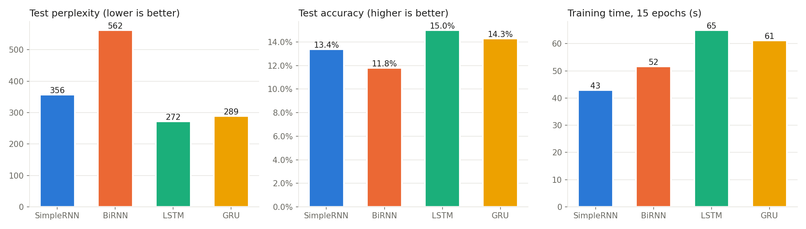
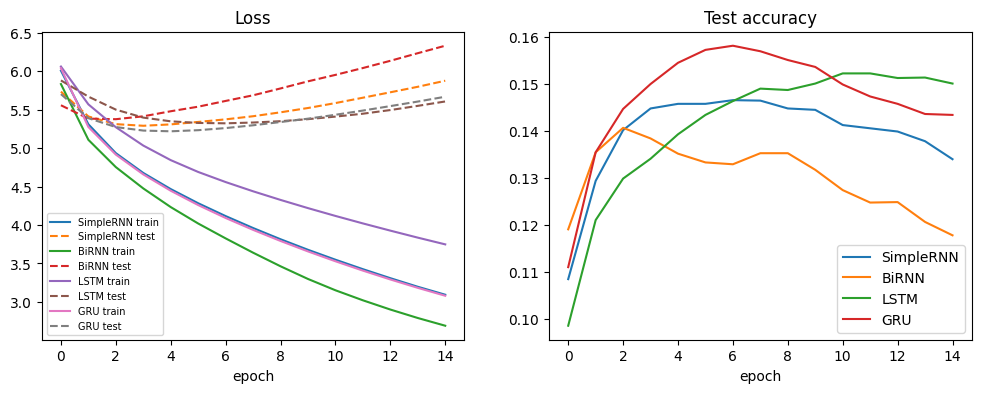
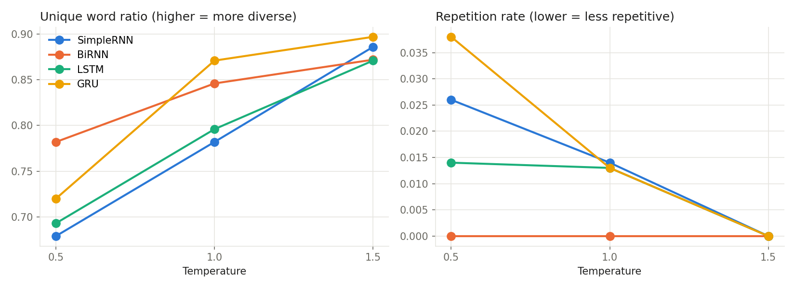

# Next-Word Text Generation on Grimms' Fairy Tales with RNN, Bidirectional RNN, LSTM and GRU

Foundations of Generative AI (ICT4403), Assignment 2

## Problem statement and objective

Build an autoregressive text generator that predicts the next word from the previous 10 words, then writes new text one word at a time by feeding each prediction back in as input.

The same task is solved with four recurrent models: Simple RNN, Bidirectional RNN, LSTM and GRU. All four are trained under the same conditions and compared on:

- test loss, perplexity, next-word accuracy and training time
- the text they generate: coherence, diversity, staying on the seed's topic, and repetition
- how the sampling temperature (0.5, 1.0, 1.5) changes the generated text

## Dataset

**Grimms' Fairy Tales** by Jacob and Wilhelm Grimm, translated by Edgar Taylor and Marian Edwardes.
Source: Project Gutenberg eBook #2591, https://www.gutenberg.org/ebooks/2591
Plain-text file used by the notebook: https://www.gutenberg.org/cache/epub/2591/pg2591.txt

| Property | Value |
|---|---|
| Content | Over 60 fairy tales (The Golden Bird, Hansel and Gretel, Rumpelstiltskin, Snow-White and Rose-Red, ...) |
| Characters (after removing the Gutenberg header and footer) | 530,055 |
| Total words | 102,114 |
| Unique words (vocabulary) | 4,746 |
| Most common words | the (7,044), and (5,481), to (2,669), he (2,093), a (1,920) |
| Licence | Public domain |

The text is simple narrative English with a lot of repetition ("once upon a time", "the king's daughter", "went into the forest"). This makes it a good size and style for word-level models trained in a few minutes. The vocabulary is also small enough that the output layer stays manageable.

## Preprocessing and input–target sequences

1. Download the book and remove the Project Gutenberg licence header and footer.
2. Lower-case the text and replace every character that is not a letter with a space.
3. Split the text into words and give each unique word an integer ID (ID 0 is kept for padding).
4. Slide a window over the word sequence. The input is 10 consecutive words and the target is the 11th word.
5. Split the sequences in order: the first 90% are for training (91,893 sequences) and the last 10% are for testing (10,211 sequences).

Example:

```
input : grimms fairy tales by jacob grimm and wilhelm grimm preparer
target: s
```

## Models

All four models use the same layers, and only the recurrent layer changes:

```
Embedding(4747, 100) -> recurrent layer (128 units) -> Dense(4747, softmax)
```

| Model | Recurrent layer | Description |
|---|---|---|
| Simple RNN | `SimpleRNN(128)` | Basic recurrence, h_t = tanh(W x_t + U h_{t-1} + b). Fast, but suffers from vanishing gradients over longer contexts. |
| Bidirectional RNN | `Bidirectional(SimpleRNN(128))` | Reads the 10 input words forwards and backwards and joins both final states. It never sees the target word, so generation is still autoregressive. |
| LSTM | `LSTM(128)` | Input, forget and output gates plus a cell state, which help it keep information across the sequence. |
| GRU | `GRU(128)` | Update and reset gates. Similar idea to the LSTM, with fewer parameters. |

Training settings shared by all four models: Adam optimiser, sparse categorical cross-entropy loss, batch size 128, 15 epochs, random seed 42, and the same train/test split.

## Repository structure

```
.
├── README.md
├── requirements.txt
├── text_generation_rnn_lstm_gru.ipynb   # full code, run on Kaggle (GPU T4), with outputs
├── results/
│   ├── model_comparison.csv             # test loss, perplexity, accuracy, training time
│   ├── training_log.csv                 # loss and accuracy for every epoch of every model
│   ├── temperature_metrics.csv          # diversity and repetition per model and temperature
│   └── plots/
│       ├── training_curves.png
│       ├── model_comparison.png
│       └── temperature_effect.png
└── samples/
    └── generated_text.md                # all 24 generated texts
```

## How to run

On Kaggle (this is how the results were produced):

1. Upload `text_generation_rnn_lstm_gru.ipynb` to Kaggle.
2. In the notebook settings, set the accelerator to GPU and turn on Internet (the notebook downloads the book from Project Gutenberg).
3. Click Run All. The whole notebook takes about 5 minutes on a T4 GPU.

Locally:

```bash
pip install -r requirements.txt
jupyter notebook text_generation_rnn_lstm_gru.ipynb
```

Dependencies: Python 3.10+, TensorFlow 2.15+, NumPy, pandas, Matplotlib.

## Results

### Quantitative comparison (test set, after 15 epochs)

| Model | Test loss | Perplexity | Accuracy | Training time (s) |
|---|---|---|---|---|
| Simple RNN | 5.876 | 356.4 | 13.4% | 42.9 |
| Bidirectional RNN | 6.331 | 562.0 | 11.8% | 51.7 |
| **LSTM** | **5.606** | **272.2** | **15.0%** | 64.9 |
| GRU | 5.668 | 289.5 | 14.3% | 61.2 |



### Training curves



| Model | Lowest test loss (epoch) | Perplexity at that epoch | Train accuracy at epoch 15 |
|---|---|---|---|
| Simple RNN | 5.290 (epoch 4) | 198.4 | 33.8% |
| Bidirectional RNN | 5.376 (epoch 3) | 216.1 | 40.0% |
| LSTM | 5.322 (epoch 7) | 204.8 | 23.7% |
| GRU | 5.218 (epoch 5) | 184.6 | 33.6% |

## Model comparison and evaluation

**Loss and perplexity.** After 15 epochs the LSTM has the lowest test loss (5.606) and perplexity (272). The GRU is close behind (289), and both are clearly better than the Simple RNN (356) and the Bidirectional RNN (562). A perplexity of 272 means that, on average, the LSTM is about as uncertain as if it were choosing between 272 equally likely words, out of a vocabulary of 4,746.

**Accuracy.** The LSTM predicts the exact next word 15.0% of the time, against 14.3% for the GRU, 13.4% for the Simple RNN and 11.8% for the Bidirectional RNN. These numbers look low, but next-word prediction in open narrative text has many valid answers, so accuracy is not expected to be high.

**Overfitting.** Every model's training loss kept falling for all 15 epochs, but test loss reached its minimum early and then rose again (see the training curves):

- The Bidirectional RNN overfits the most. It reaches 40.0% training accuracy but only 11.8% test accuracy, and its test loss starts rising after epoch 3. Reading the context in both directions doubles its recurrent parameters, and it uses that capacity to memorise the training text.
- The Simple RNN and GRU start overfitting after epochs 4 and 5.
- The LSTM learns more slowly. Its training accuracy at epoch 15 is only 23.7%, and its test loss keeps improving until epoch 7. That is why it finishes with the best test numbers.
- The GRU reached the lowest test loss of any model at any point (5.218 at epoch 5, perplexity 185), but by epoch 15 it had overfitted past the LSTM.

**Training time.** The Simple RNN is the fastest (42.9 s), followed by the Bidirectional RNN (51.7 s). The GRU (61.2 s) and LSTM (64.9 s) are slower because their gates need more computation per step. The GRU is about 6% faster than the LSTM.

**Quality of generated text.** At temperature 0.5 (seed: "once upon a time there was a king who had"):

| Model | Generated continuation |
|---|---|
| Simple RNN | ...no sorrow and meek and the father saw that the bird was the king s daughter and sat down down on a couch and the soldier fell into the castle |
| Bidirectional RNN | ...not a man who was so serious that two one could have a long long they were gone on and took a very unhappy to the great hunger and said |
| LSTM | ...been at the fox and the king said he would not be a man who was so beautiful and he went to the castle and said to himself what he |
| GRU | ...a son and the wedding was to be a chandelier in the night the thought of the little house he had a son and said to himself he will be |

- **Coherence:** the LSTM and GRU produce the most readable fairy-tale phrases ("the king said he would not be...", "he went to the castle and said to himself"). The Simple RNN produces local phrases but jumps between characters (bird, daughter, soldier). The Bidirectional RNN often breaks grammar ("took a very unhappy to the great hunger").
- **Contextual consistency:** the LSTM and GRU stay with the king from the seed ("the king said", "he had a son"). The other two models drift away quickly.
- **Diversity:** at T = 0.5 the Bidirectional RNN has the highest unique-word ratio (0.782), but much of that comes from broken, random word choices rather than richer language. Among the readable models, the GRU (0.720) is a little more varied than the LSTM (0.693).
- **Repetition:** with only 30 generated words, repetition is low for every model. The highest values are for the GRU (0.038) and Simple RNN (0.026) at T = 0.5, for example the Simple RNN's "sat down down". The GRU repeats "he had a son".

All 24 generated texts are in [samples/generated_text.md](samples/generated_text.md).

## Sampling-temperature analysis

The model's output probabilities are rescaled with p_i ∝ exp(log p_i / T) before a word is sampled. A low T sharpens the distribution towards the most likely words, and a high T flattens it.

| Temperature | Avg. unique word ratio (4 models) | Avg. repetition rate (4 models) |
|---|---|---|
| 0.5 | 0.719 | 0.020 |
| 1.0 | 0.824 | 0.010 |
| 1.5 | 0.882 | 0.000 |



- **T = 0.5:** the most coherent and grammatical text, made of common fairy-tale phrases ("went to the castle", "said to himself"). Diversity is lowest, and this is the only setting where repeated word pairs show up.
- **T = 1.0:** the vocabulary widens and repetition halves, but sentences start to lose structure. For example, the GRU wrote "...the dog said he i pronounce stuck with water so drink four hair in your gloom". Short phrases are still fluent, but the meaning across the sentence breaks down.
- **T = 1.5:** the most diverse output with no repetition at all, but it is close to random word lists ("so that thus was long knock take taste pomp that tremendous heart" from the Bidirectional RNN). Coherence and connection to the seed are lost for every model.

Diversity rises and repetition falls steadily as temperature goes up, while coherence falls. For this dataset and model size, T = 0.5 gives the most usable text, and T = 1.0 is the upper limit before the output stops reading like a story.

## Conclusion

**The LSTM is the best model for autoregressive generation on this dataset.** After 15 epochs it has the lowest test perplexity (272.2) and the highest next-word accuracy (15.0%). At T = 0.5 it also produced the most coherent continuations that stayed on the seed's topic. Its gates let it track context across the 10-word window, and it overfitted more slowly than the other three models, so it held up best under identical training conditions.

The GRU is a close second. It trains about 6% faster, and its test loss at epoch 5 was the lowest of any model, so with early stopping it could match or beat the LSTM. The Simple RNN is the fastest but less accurate and less coherent. The Bidirectional RNN is the weakest. Reading the context backwards does not help when the task is to predict the next word, and the extra parameters made it overfit the fastest.

**Limitations.**

- The models were trained for a fixed 15 epochs with no early stopping or dropout, so all four overfit. The test split was also used for the per-epoch validation curves.
- Removing apostrophes splits words such as "king's" into "king s".
- The diversity and repetition measures are averaged over only 2 seeds, with 30 words per sample.
